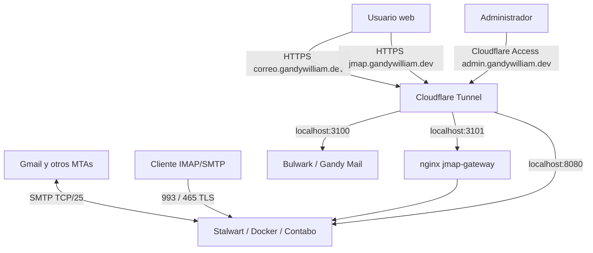

# Web Correo Propio — Gandy Mail

Documentación técnica, histórica y operativa del correo con dominio propio **gandywilliam.dev**, ejecutado sobre Contabo con Stalwart y Cloudflare y administrado mediante una webmail Bulwark personalizada.

**Corte:** 13 de noviembre de 2026, zona horaria America/Lima. El proyecto se inició con Stalwart el 12/11 y se completaron las primeras pruebas reales y el webmail el 13/11.

> **Aviso:** este repositorio es **público**. Contiene información de arquitectura y registros DNS públicos, pero deliberadamente no contraseñas, tokens Cloudflare, secretos Docker, claves privadas, cookies ni copias de buzones. Los resultados son pruebas históricas, no monitoreo permanente del VPS. Algunas acciones realizadas por Claude Code aparecen identificadas como «informadas por Claude» porque no se inspeccionó nuevamente el VPS.

## Estado resumido

| Componente | Resultado al 13/11 |
|---|---|
| Stalwart 1.1.0 en Docker | Funcionando, SMTP/IMAP verificados |
| Contabo + Cloudflare DNS | MX 10 directo a `mail.gandywilliam.dev`, SPF/DKIM/DMARC publicados, PTR IPv4 correcto |
| TLS | Let's Encrypt wildcard, certificado observado válido del 12/11/2026 al 10/02/2027 |
| Gmail → Stalwart | Prueba real recibida en `contacto@gandywilliam.dev` |
| Stalwart → Gmail | Prueba real entregada, **pero clasificada como Spam** |
| Cloudflare Access | Panel `admin.gandywilliam.dev` protegido |
| Cloudflare Tunnel | `admin`, `correo` y `jmap` configurados |
| Bulwark Webmail 1.21.2 | Desplegado según Claude; web `correo.gandywilliam.dev` responde 200 |
| JMAP | `/.well-known/jmap` → 307 → `/jmap/session` HTTP 200 |
| Correo desde Gandy Mail | «hola querido» con adjunto, recibido en Gmail en **Spam** |
| Seguridad SSH | **Pendiente urgente**: rotar contraseña reutilizada/expuesta, según hallazgo de Claude |

## Documentación paso a paso

| Archivo | Contenido |
|---|---|
| [01 — Cronología completa](docs/01-cronologia.md) | Desde planificación, instalación, recovery, Cloudflare, MX y Gmail hasta webmail |
| [02 — Arquitectura](docs/02-arquitectura.md) | Diagrama Mermaid, puertos, flujos de correo y responsabilidades |
| [03 — DNS, Cloudflare y TLS](docs/03-cloudflare-dns-tls.md) | Registros, Tunnel, Access, ACME DNS-01, PTR, migración Email Routing |
| [04 — VPS y Stalwart](docs/04-stalwart-vps.md) | Docker, contenedores, volúmenes, wizard, recovery, listeners, auditoría |
| [05 — Pruebas de correo](docs/05-pruebas-correo.md) | Comandos y resultados de `dig`, `curl`, IMAP, SMTP y Gmail |
| [06 — Bulwark y JMAP](docs/06-bulwark-jmap.md) | Código editable, deploy de Claude, gateway, túnel y actualizaciones |
| [07 — Seguridad e incidentes](docs/07-seguridad-incidentes.md) | Fallos encontrados, resoluciones, hallazgo de credencial SSH y mitigación |
| [08 — Operación y mantenimiento](docs/08-operacion-mantenimiento.md) | Diagnóstico, backup, actualizaciones, recuperación y no regresión |
| [09 — Estado y pendientes](docs/09-estado-pendientes.md) | Confirmaciones, límites y prioridades siguientes |

## Arquitectura simplificada

## Datos públicos de servicio

- Mail host: `mail.gandywilliam.dev` (DNS-only, no proxy HTTP).
- MX: `10 mail.gandywilliam.dev.`
- Entrante IMAP: `mail.gandywilliam.dev:993` (TLS).
- Saliente SMTP: `mail.gandywilliam.dev:465` (TLS).
- Webmail: [correo.gandywilliam.dev](https://correo.gandywilliam.dev).
- JMAP: [jmap.gandywilliam.dev](https://jmap.gandywilliam.dev/.well-known/jmap).
- Panel Stalwart: [admin.gandywilliam.dev](https://admin.gandywilliam.dev) (**Access protegido**).
- Proyecto webmail upstream: [bulwarkmail/webmail](https://github.com/bulwarkmail/webmail).

## Principios de operación

No alterar el servicio de gimnasio (puertos 80/443), no abrir el panel Stalwart directamente, no ejecutar limpieza global de volúmenes Docker y no subir datos/credenciales. Antes de actualizar Stalwart/Bulwark, crear copias verificables y probar rollback. Los scripts del despliegue preparados por Claude permanecen **en el VPS** y esta documentación **no es una exportación de su contenido ni de configuraciones sensibles**.

## Trabajo pendiente prioritario

**1.** Cambiar contraseña SSH/sudo reportada como expuesta y retirar sus copias públicas. **2.** Revisar «Mostrar original» en Gmail y resultados SPF/DKIM/DMARC para diagnosticar Spam. **3.** Auditar gateway JMAP, proxies y backups automáticos. Detalle en [09 — Pendientes](docs/09-estado-pendientes.md).

## Fuentes de la documentación

Reconstrucción de la conversación de configuración del 12–13/11/2026, capturas de Cloudflare, pruebas ejecutadas desde Arch Linux, correo recibido en Gmail e informe enviado por Claude Code sobre el VPS. Las operaciones donde solo existe informe de otro agente se identifican como tales.
