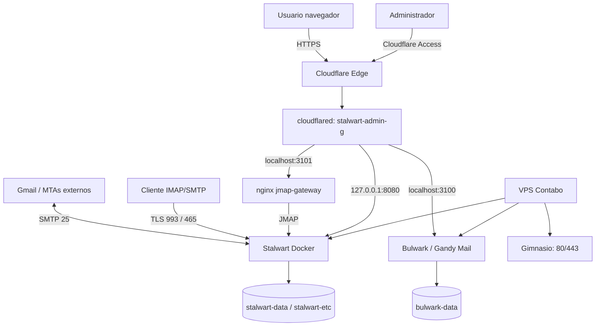

# Arquitectura, tráfico y servicios

## Esquema

## Responsabilidades

| Servicio | Responsabilidad |
|---|---|
| Cloudflare DNS | A/MX/TXT/CNAME y registros de correo |
| Contabo | VPS e IP; PTR inverso IPv4 |
| Stalwart 1.1.0 | SMTP/IMAP/JMAP, autenticación, almacenamiento |
| Docker | Contenedores, puertos y volúmenes |
| Cloudflare Tunnel | Acceso HTTPS a servicios locales sin ocupar 80/443 |
| Cloudflare Access | Protección de `admin.gandywilliam.dev` |
| Let's Encrypt/ACME DNS-01 | Certificado wildcard servido por Stalwart |
| Bulwark 1.21.2 | Frontend webmail editable |
| nginx jmap-gateway | Proxy filtrado a JMAP con reescritura y CORS, según Claude |

## Rutas del túnel

| Hostname | Servicio local | Seguridad |
|---|---|---|
| `admin.gandywilliam.dev` | `http://127.0.0.1:8080` | Cloudflare Access individual, 24 h |
| `correo.gandywilliam.dev` | `http://localhost:3100` | Login de Bulwark |
| `jmap.gandywilliam.dev` | `http://localhost:3101` | Autenticación JMAP; filtro nginx y CORS |

Las rutas publicadas de `correo` y `jmap` fueron confirmadas por Cloudflare; su seguridad completa (incluido rate limiting e IP real) requiere auditoría posterior. No imponer Access HTML sobre la API JMAP sin diseñar un método compatible.

## Puertos del VPS

| Host | Puerto contenedor | Acceso |
|---|---|---|
| 0.0.0.0:25 | Stalwart 25 | SMTP público |
| 0.0.0.0:465 | Stalwart 465 | SMTPS público |
| 0.0.0.0:993 | Stalwart 993 | IMAPS público |
| 127.0.0.1:8080 | Stalwart 8080 | Panel vía túnel |
| 127.0.0.1:8443 | Stalwart 443 | HTTPS local |
| 127.0.0.1:3100 | Bulwark 3000 | Webmail vía túnel (reportado por Claude) |
| 127.0.0.1:3101 | nginx gateway | JMAP vía túnel (reportado por Claude) |
| 0.0.0.0:80/443 | gym-frontend | **No modificar** |

Puerto 587 no fue publicado; 995/4190 figuran como listeners en Stalwart, sin publicación externa confirmada. IPv6 PTR permaneció en hostname previo, por lo que no se anunció para correo.

## Flujo SMTP

Gmail envía a la cuenta del dominio → consulta MX `gandywilliam.dev` → `mail.gandywilliam.dev` → Stalwart SMTP 25 → verifica destinatario y guarda en buzón. Para enviar, el usuario autenticado usa SMTPS 465 o JMAP webmail → Stalwart consulta MX remoto y entrega a Gmail SMTP 25. La clasificación Spam/Inbox depende del destinatario y autenticación/reputación.

## Datos y backups

`stalwart-etc`, `stalwart-data` son volúmenes persistentes **sensibles**; `bulwark-data` contiene ajustes webmail. Nunca subir volúmenes ni backups a GitHub, ni arrancar `stalwart-anterior` compartiendo los mismos datos.
